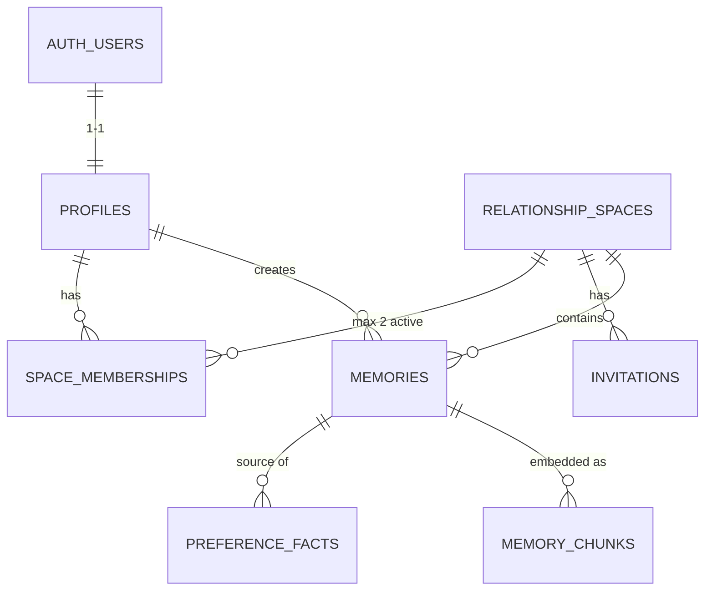

# Relationship Memory

A shared memory app for couples — store, search and revisit meaningful moments together.

## Tech stack

- **Runtime:** Node.js (LTS) + TypeScript strict
- **API:** Express 5, Zod 4, postgres.js
- **DB:** Supabase (PostgreSQL + pgvector)
- **Monorepo:** pnpm workspaces
- **Testing:** Vitest + Supertest
- **CI:** GitHub Actions

## Data model



## How to run

**Requirements:** Node LTS, pnpm, Docker Desktop, Supabase CLI

```bash
pnpm install
cp apps/api/.env.example apps/api/.env
pnpm dev:api
```

```bash
pnpm test
```
