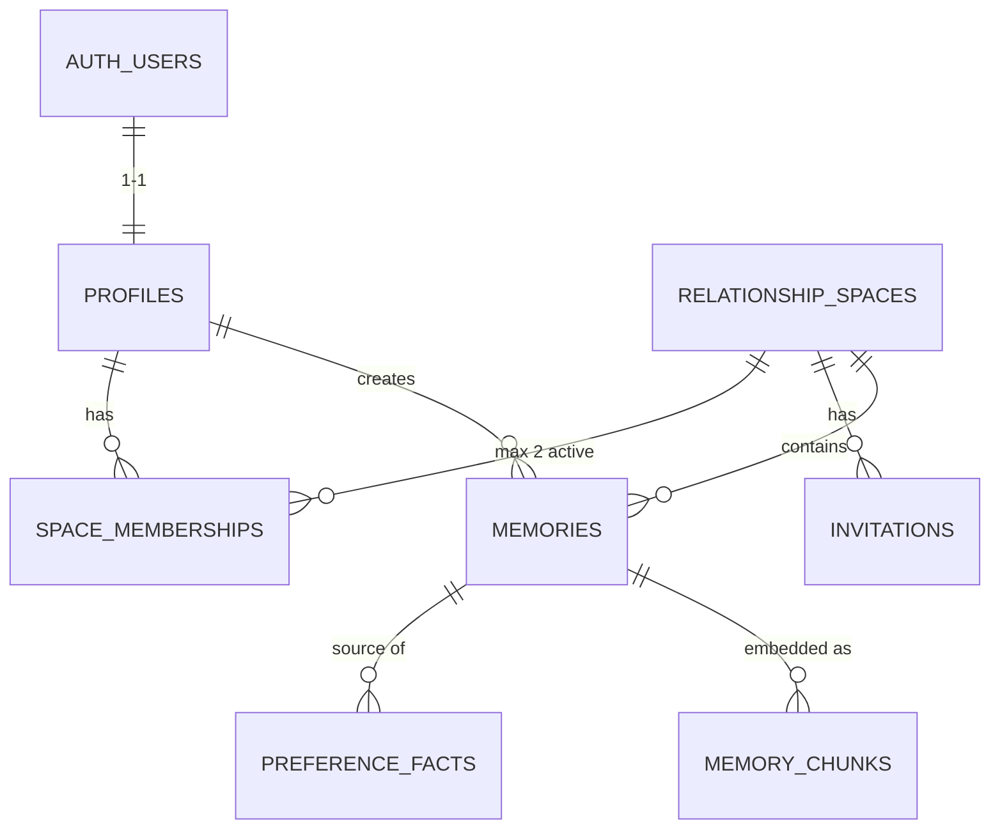

# Relationship Memory

A shared memory app for couples — store, search and revisit meaningful moments together.

## Tech stack

- **Runtime:** Node.js (LTS) + TypeScript strict
- **API:** Express 5, Zod 4, postgres.js
- **DB:** Supabase (PostgreSQL + pgvector)
- **Monorepo:** pnpm workspaces
- **Testing:** Vitest + Supertest
- **CI:** GitHub Actions

## Data model



## AI / LLM provider

The worker embeds memories using a configurable LLM provider (`LLM_PROVIDER` in `.env`).

| Provider | Data sent | Notes |
|---|---|---|
| `fake` | Nothing — hash-based vectors, no network calls | Used in CI and tests |
| `gemini` | Memory title + body chunks to Google Generative Language API | Gemini free-tier data **may be used by Google to improve their models**. Only send dummy/seed data on free tier (FR-18.6, FR-18.7). Use a paid API key for real couple data. |

The API key is never logged or included in responses. It lives only in `apps/api/.env` (gitignored).

## How to run

**Requirements:** Node LTS, pnpm, Docker Desktop, Supabase CLI

```bash
pnpm install
cp apps/api/.env.example apps/api/.env
pnpm dev:api
```

```bash
pnpm test
```
