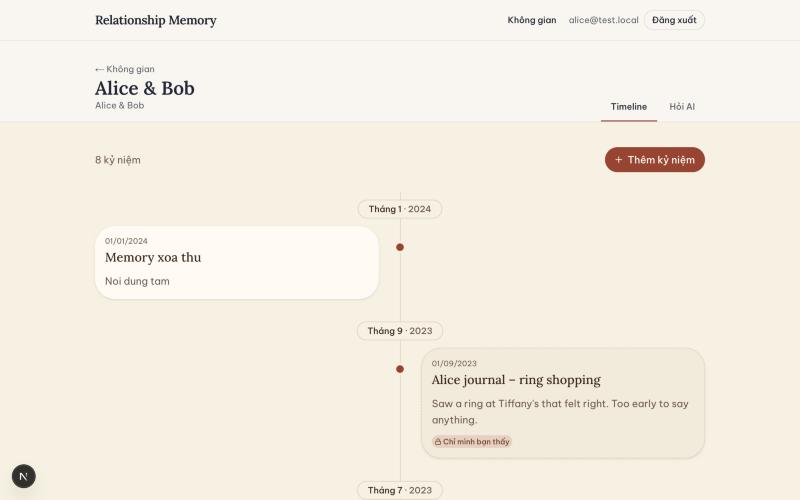
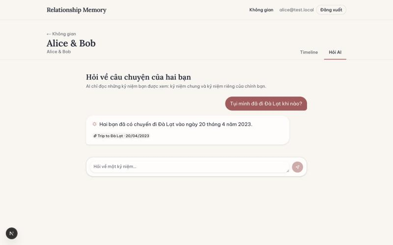
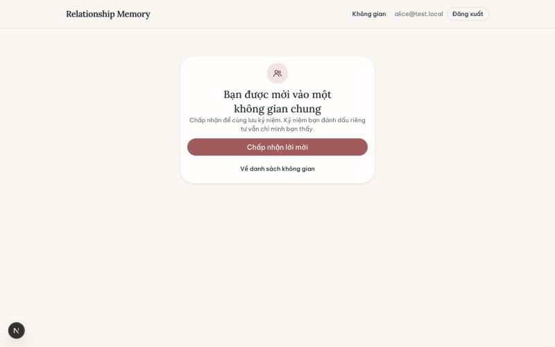
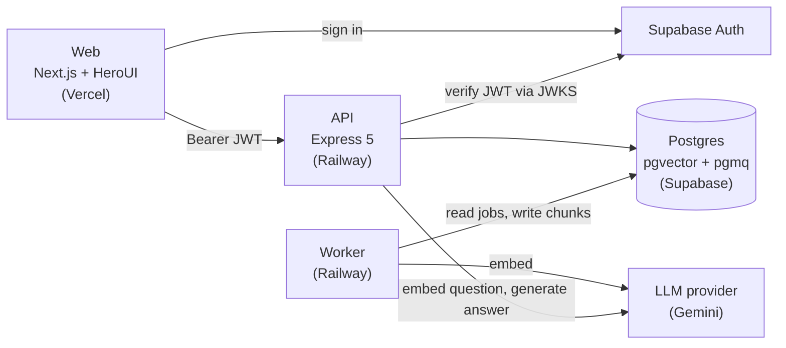
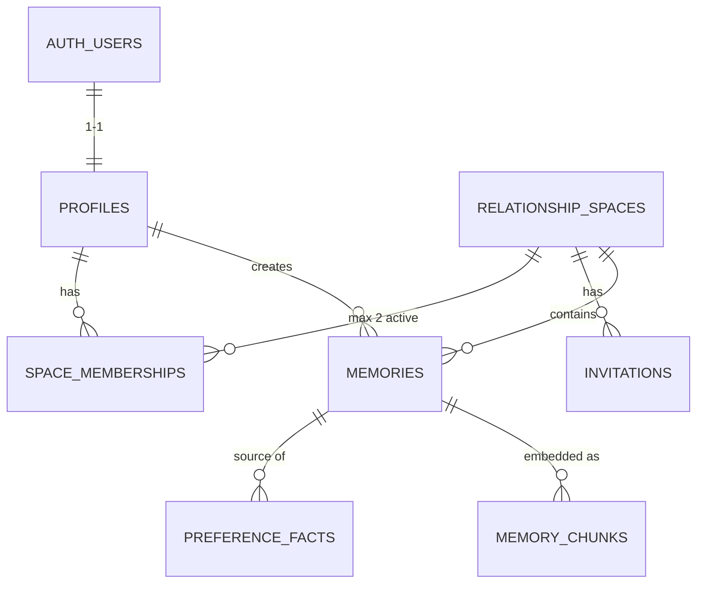

# Relationship Memory

A private shared memory album for couples: save moments together, choose what stays private, and ask an AI about your own story with cited sources.


## Live demo

- Web: _coming soon (Vercel)_
- API health: _coming soon (Railway)_ `/health`

Demo accounts (shared space "Alice & Bob"; the password is shared on request, not committed):

| Account | Role |
|---|---|
| `alice@test.local` | Space owner |
| `bob@test.local` | Partner |

Log in as Alice, then as Bob in a private window: each sees shared memories plus only their own private ones, and the AI follows the same rule.

## Screenshots

| Timeline | AI chat with sources | Invitation |
|---|---|---|
|  |  |  |

## Highlights

- **88 automated tests** in CI (84 API + 4 shared schema), including a **24-case table-driven authorization matrix** (creator / partner / outsider / anonymous × shared / private × GET / PATCH / DELETE).
- **Permission-filtered RAG:** the privacy filter runs inside the same SQL query as the vector `ORDER BY … LIMIT k`, so a partner's private memory never reaches the LLM. Proven by tests on the exact prompt the LLM receives.
- **AI eval: 14/15 (93%)** on a 15-question set, with **0 private-memory leaks** (noLeak 2/2).
- **Transactional background jobs:** a memory save and its embedding job commit in one transaction (pgmq), with retries, exponential backoff, dead-lettering and idempotent workers. Saves still succeed when the AI provider is down.
- **Concurrency:** optimistic locking on memory edits (`409 VERSION_CONFLICT`) and a row lock when accepting invitations, so two people cannot join a full space at once.

## Architecture



- **Monorepo** (pnpm workspaces): `apps/api` (API + worker), `apps/web`, `packages/shared` (Zod schemas used by both client and server).
- **One Docker image, two processes:** `node dist/server.js` and `node dist/worker.js` ([ADR-001](docs/adr/001-worker-entry-in-api-package.md)).
- **The web app holds no business rules:** every permission check lives in the API, so a future mobile app uses the same API.

## Data model



### Authorization matrix (memory endpoints)

| Actor | GET shared | GET private | PATCH shared | PATCH private | DELETE shared | DELETE private |
|---|---|---|---|---|---|---|
| Creator | 200 | 200 | 200 | 200 | 204 | 204 |
| Partner | 200 | 404 | 403 | 404 | 403 | 404 |
| Outsider | 404 | 404 | 404 | 404 | 404 | 404 |
| Anonymous | 401 | 401 | 401 | 401 | 401 | 401 |

A private memory returns 404 rather than 403 to anyone but its creator, so its existence is not revealed.

## Key decisions

- [ADR-001: Worker entry point in the API package](docs/adr/001-worker-entry-in-api-package.md)
- **pgvector instead of a separate vector DB:** deleting a memory cascades to its embeddings in the same transaction.
- **Visibility is not copied onto chunks:** retrieval joins back to `memories`, so switching shared → private applies to the AI immediately.
- **No network calls inside transactions:** the worker embeds first, then re-checks the memory version under a row lock before writing.

## Run locally

**Requirements:** Node 26 (see `.node-version`), pnpm, Docker Desktop, Supabase CLI.

```bash
pnpm install
supabase start
cp apps/api/.env.example apps/api/.env   # fill in values from `supabase status`
pnpm db:reset                            # migrations + seed data + embedding jobs
```

Run each in its own terminal:

```bash
pnpm dev:api      # http://localhost:4000
pnpm dev:worker   # embeds memories in the background
pnpm dev:web      # http://localhost:3000 (needs apps/web/.env.local)
```

`apps/web/.env.local`:

```bash
NEXT_PUBLIC_SUPABASE_URL=http://127.0.0.1:54321
NEXT_PUBLIC_SUPABASE_ANON_KEY=<anon key from supabase status>
NEXT_PUBLIC_API_URL=http://localhost:4000
```

Checks and builds:

```bash
pnpm lint && pnpm typecheck && pnpm test
pnpm --filter @rm/api eval                       # AI eval, needs a real LLM_API_KEY
docker build -f apps/api/Dockerfile -t rm-api .  # production image
```

Deployment steps: [docs/deploy.md](docs/deploy.md).

## AI eval

`pnpm --filter @rm/api eval` asks 15 questions against the seed data (10 answer, 3 unknown, 2 noLeak) and exits with code 1 below 90%.

| Date | Provider | Score | Notes |
|---|---|---|---|
| 2026-11-16 | gemini | 14/15 (93%) | noLeak 2/2; q2 returned found=false |

## Known limitations and roadmap

- Not built yet: photos and media (signed URLs), theme presets and theme builder, realtime updates, "Remember When", notifications, mobile app (HeroUI Native), streamed AI answers (SSE).
- Private pages render in the browser after sign-in (no server-side rendering with cookies yet).
- The worker exits if the database connection fails and relies on the platform to restart it.
- A failed AI job shows an error chip but has no "retry" button yet.

## Data sent to the AI provider

The worker and the chat endpoint call the provider set by `LLM_PROVIDER`.

| Provider | Data sent | Notes |
|---|---|---|
| `fake` | Nothing (hash-based vectors, no network calls) | Used in CI and tests |
| `gemini` | Memory title and body chunks (embedding), the question plus retrieved memories the asker may see (answer) | Gemini free-tier data **may be used by Google to improve its models**. Only seed or demo data is sent on the free tier (FR-18.6, FR-18.7). Use a paid key for real couple data. |

API keys live only in environment variables, are never logged, and are never committed.
